# Banking Customer & Loan Analytics — LendingClub 2007–2011

Portfolio, customer and credit-risk analysis of **42,535 personal loans ($460.3M funded)** issued by
LendingClub, with the final repayment outcome of 40,347 finished loans.

**Tools:** Python (pandas, NumPy, Matplotlib, Seaborn) · SQL (PostgreSQL) · Excel · Power BI · Jupyter

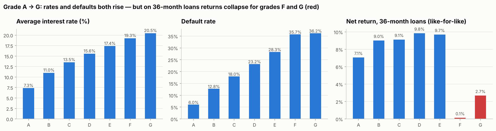

---

## Business problem

A lender's credit-risk team needs to know **what the loan book looks like, who the borrowers are, which loans default and
whether interest rates pay for the losses**, so it can tighten policy where losses are high and grow where risk-adjusted
returns are good.

## Objectives

1. Describe the portfolio: volume, amounts, terms, grades, purposes and growth.
2. Profile customers: income, debt-to-income, employment, home ownership, verification, region.
3. Measure risk: default rate, principal lost, loss-given-default — overall and by segment.
4. Test pricing: does the interest rate compensate for default risk by grade?
5. Evaluate policy exceptions and simple risk indicators; recommend actions.

## Dataset

| | |
|---|---|
| Name | LendingClub loan data — loans issued 2007–2011 (`LoanStats3a.csv`); LendingClub's original file, also republished on Kaggle in several datasets |
| Publisher | LendingClub Corporation (public loan statistics) |
| Size | 42,535 loans × 74 columns (one row = one borrower) |
| Period | Issued 2007-06 – 2011-12; outcomes as of Dec 2015 |
| Provenance | Original zip from a public GitHub mirror, cross-checked with 2 independent copies and LendingClub's own control total — see [`data/raw/SOURCE.md`](data/raw/SOURCE.md) |

**Not in this data (not invented):** approval/rejection rates (only approved loans are included), credit score, age,
gender, and branches (LendingClub is online-only — state and US region are used instead).

## Project architecture

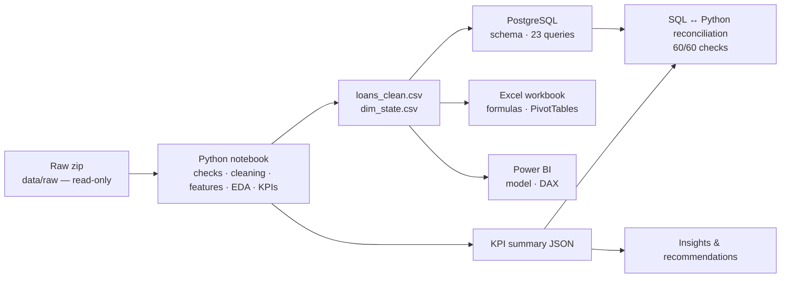

## Data cleaning (summary)

* Skipped the title line, removed 3 non-loan text rows; reconciled to LendingClub's control total ($471,701,350).
* Dropped 30 columns (21 completely empty for 2007–2011 loans, plus single-value/free-text fields).
* Converted `" 10.65%"`, `" 36 months"`, `"10+ years"`, `"Dec-2011"` to numbers and dates.
* Split "Does not meet the credit policy" out of `loan_status` into its own flag (2,749 loans).
* Defined outcome (Fully Paid / Charged Off / Active) and used **finished loans only** for default rates.
* Checked installments against the amortisation formula (99.97% match) and payment components.

Details: [`docs/data_cleaning.md`](docs/data_cleaning.md) · log: [`reports/cleaning_log.csv`](reports/cleaning_log.csv)

## SQL analysis (PostgreSQL)

[`sql/schema.sql`](sql/schema.sql) · [`sql/load_data.sql`](sql/load_data.sql) · [`sql/analysis_queries.sql`](sql/analysis_queries.sql) (23 queries:
GROUP BY/HAVING, CASE, INNER/LEFT JOIN, subqueries, CTEs, `PERCENTILE_CONT`, `LAG`, running totals, `RANK`,
`DENSE_RANK`, `ROW_NUMBER`, `NTILE`) · [`sql/business_questions.md`](sql/business_questions.md) (question + actual result per query) ·
outputs in [`sql/results/`](sql/results/) · **reconciliation 60/60** ([report](reports/sql_python_reconciliation.md)).

## Python analysis

[`notebooks/banking_loan_analysis.ipynb`](notebooks/banking_loan_analysis.ipynb) — executed end to end: loading the raw zip,
shape/types/missing/duplicates, data-quality checks, logged cleaning, feature engineering, descriptive statistics, EDA,
KPIs, vintage trends, segment analysis (grade, term, purpose, verification, policy, income, DTI, utilisation, inquiries,
home ownership, employment, high-value customers, regions/states), correlation with default, findings and recommendations.

## Excel workbook

[`excel/loan_portfolio_analysis.xlsx`](excel/loan_portfolio_analysis.xlsx) (11 MB): the cleaned loans as an Excel Table with helper
formulas (`YEAR`, `VLOOKUP` exact/approximate, `IFS`, `IF`), analysis sheets built with `COUNTIFS`, `SUMIFS`, `AVERAGEIFS`,
`PERCENTILE.INC`, `IFERROR`, a grade × term matrix with colour scales, a 5-flag risk score, vintage and monthly running
totals, **native PivotTables**, and a ✓/✗ check of every KPI against Python.
Verified by a full recalculation: **46/46 checks passed** ([report](reports/excel_verification.md)).

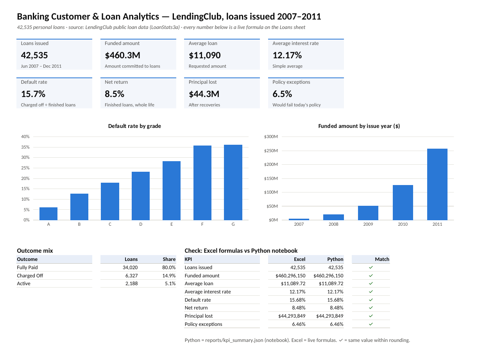
*Summary sheet of the workbook — rendered from the actual `.xlsx` file with LibreOffice.*

## Power BI dashboard

[`powerbi/Banking_LendingClub.pbix`](powerbi/Banking_LendingClub.pbix) — 3-page dashboard built in Power BI Desktop on a star schema
(loans fact; state and issue-date dimensions) with **28 DAX measures** (default rate, net return, loss given default, YoY, running total, Top-N):
**Executive Overview · Detailed Analysis · Business Insights**, with synced Issue year, Grade and Region slicers.
Model, refresh steps and expected values: [`powerbi/README.md`](powerbi/README.md).

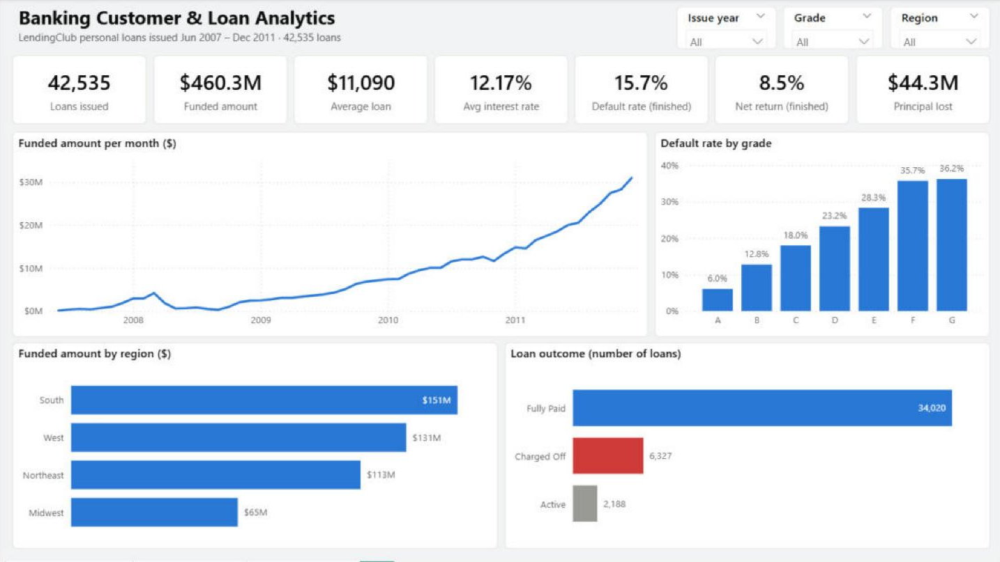

## KPIs

| KPI | Value | KPI | Value |
|---|---|---|---|
| Loans | 42,535 | Default rate (finished loans) | 15.7% |
| Funded amount | $460.3M | Principal lost (after recoveries) | $44.3M |
| Average loan | $11,090 | Loss given default | 61.4% |
| Average interest rate | 12.17% | Net return (finished loans) | 8.5% |
| 60-month share | 25.9% | Policy exceptions | 6.5% |
| Median income | $59,000 | Funding rate | 97.6% |

## Key insights

1. **Grades F–G are under-priced:** on 36-month loans net return rises to 9.8% (D) but falls to 0.1% (F) and 2.7% (G).
2. **60-month loans default 27.8% vs 12.3%** — worse inside every grade.
3. **Small business is the riskiest purpose (29.3%)**; credit-card refinancing 11.5%.
4. **High-income (top 10%) customers default 12.6% vs 16.0%** and returned 12.3% vs 7.8%.
5. **Credit stress predicts default:** utilisation 100%+ → 37.9%; 4+ inquiries → 27.4%.
6. **A 5-flag risk score works:** 0 flags 8.7% vs 3 flags 33.8% default.
7. **Policy exceptions defaulted 27.7%** vs 14.8%.
8. **Missing employment length = red flag** (23.2% vs 15.5%).

All 12 insights: [`reports/insights.md`](reports/insights.md)

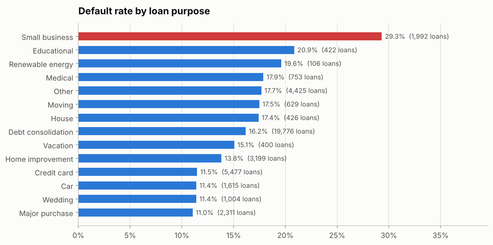

## Business recommendations

1. Tighten small-business lending (documentation, lower limits or higher rates).
2. Offer 60-month terms only to grades A–B, or price them higher.
3. Manual review for 3+ risk flags (DTI ≥ 20, utilisation ≥ 75%, 3+ inquiries, 60-month, small business).
4. Re-price or cap grades F–G.
5. Keep the tightened credit policy; review applications with missing employment data.
6. Grow high-income and B–E 36-month segments in lower-risk states.
7. Collect rejected-application data to measure approval rates.

## How to run

```bash
pip install -r requirements.txt
jupyter notebook notebooks/banking_loan_analysis.ipynb        # Restart & Run All -> creates data/cleaned/

createdb lending_db                                            # PostgreSQL 13+, run from the project root
psql -d lending_db -f sql/schema.sql
psql -d lending_db -f sql/load_data.sql
python scripts/run_sql_queries.py --db lending_db             # saves results to sql/results/
python scripts/reconcile_sql_python.py                        # SQL vs Python check
```

## Folder structure

```text
banking-loan-analytics/
├── README.md · requirements.txt · .gitignore
├── data/raw/           # LoanStats3a.csv.zip (original, read-only) + SOURCE.md
├── data/cleaned/       # loans_clean.csv, dim_state.csv
├── notebooks/          # banking_loan_analysis.ipynb (executed)
├── sql/                # schema, load, 23 queries, business_questions.md, results/
├── excel/              # loan_portfolio_analysis.xlsx
├── powerbi/            # Banking_LendingClub.pbix (3-page dashboard), measures.dax, power_query.m
├── reports/            # insights.md, kpi_summary.json, cleaning log, SQL reconciliation, Excel verification, figures/
├── docs/               # data_dictionary.md, data_cleaning.md, methodology.md
├── scripts/            # run_sql_queries.py, reconcile_sql_python.py
└── screenshots/        # Power BI pages + Excel Summary
```

## Screenshots

| | |
|---|---|
| 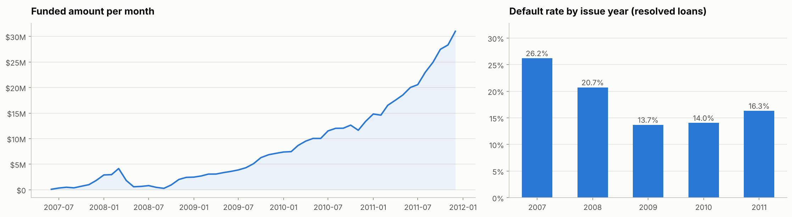 | 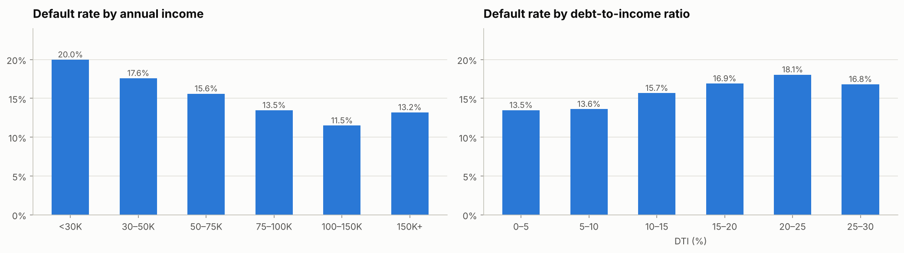 |
| 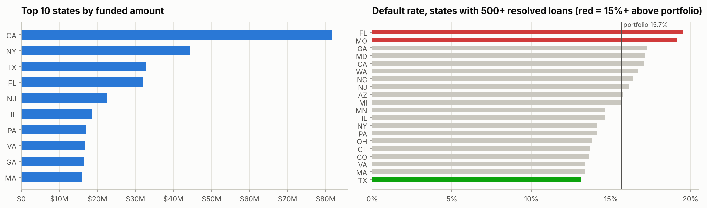 | 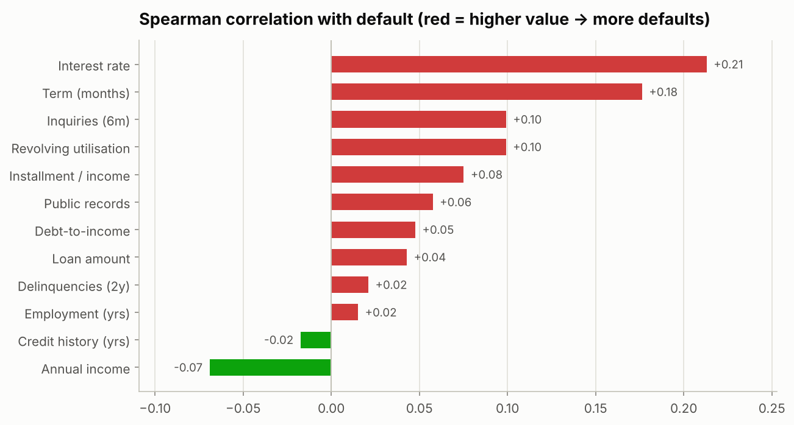 |
| 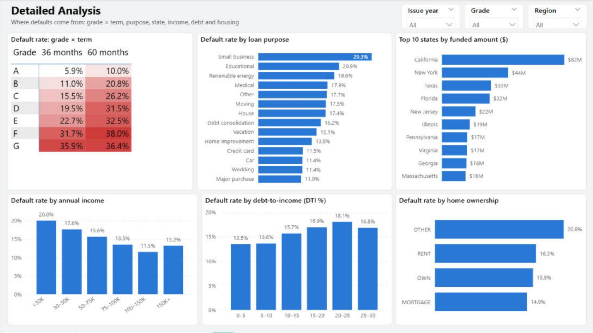 | 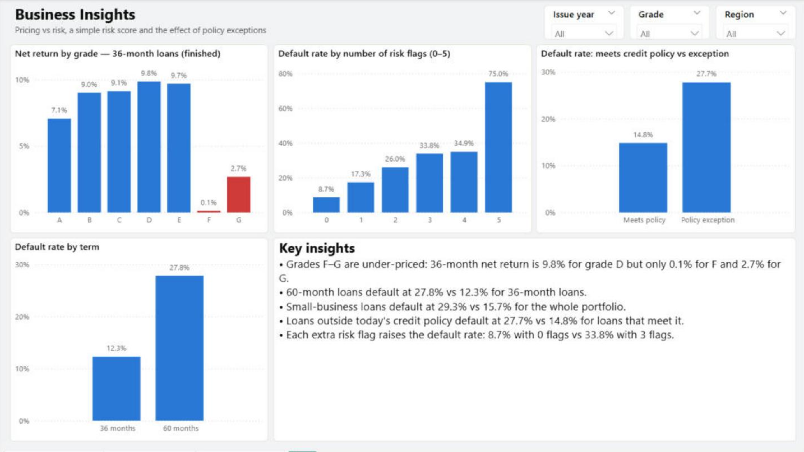 |

## Limitations

* Approved loans only → no approval/rejection analysis; no credit score, age or gender.
* 2007–2011 includes the financial crisis; 9.8% of 2011 loans were still active in the Dec-2015 extract.
* Net return is total, not annualised, and ignores fees and the time value of money.
* Correlation is not causation; LendingClub's grade already summarises many risk factors.

## Future improvements

* Add LendingClub's rejected-applications file to analyse approval rates.
* Build a simple probability-of-default model (logistic regression) and compare it with the 5-flag score.
* Annualised returns (IRR) by grade and term.
* Extend to 2012–2018 loans to compare vintages after the crisis.

---
*Author: Jatin Gohel · Data: LendingClub public loan data · All numbers come from `reports/kpi_summary.json` and `sql/results/`.*
